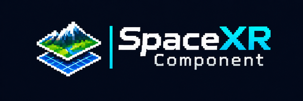
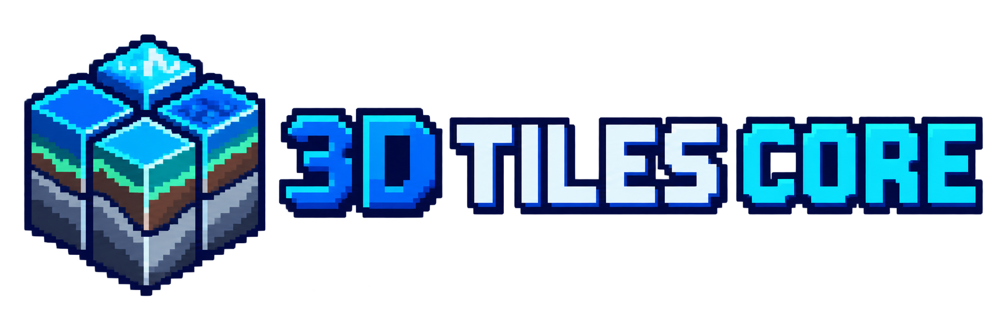
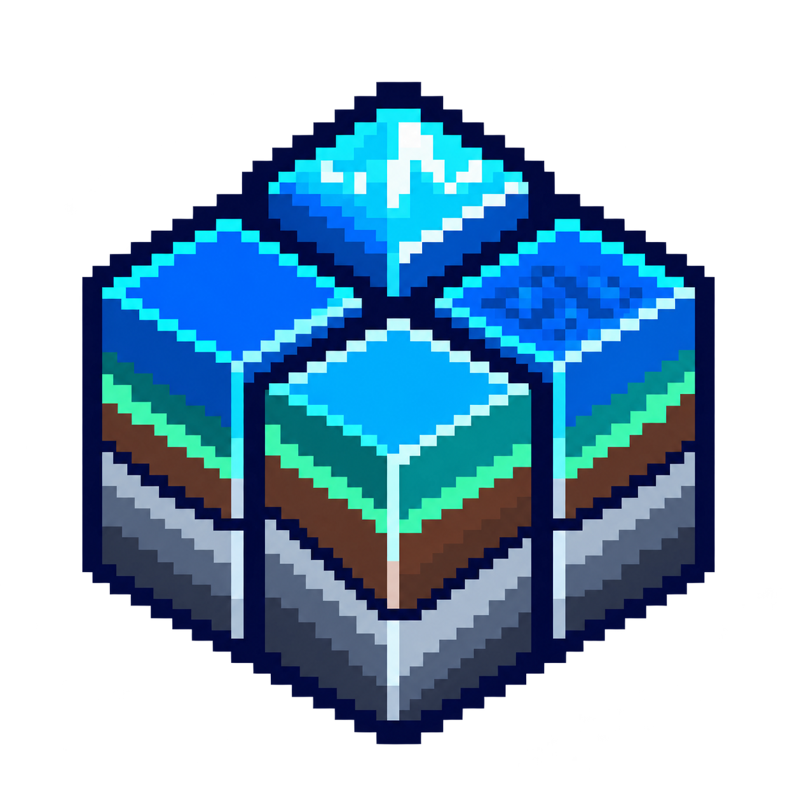

[](https://github.com/pandaGaume/3d-tiles-core/actions/workflows/ci-node.yml)
[](LICENSE)



<p align="center">
  
</p>

# 3D Tiles Core

`3d-tiles-core` provides implementation-neutral building blocks for OGC 3D Tiles.

The repository is organized by target language so the same contracts can later be implemented for Node.js, .NET and C++ or Unreal Engine without coupling the standard model to a rendering engine.

## Repository layout

```text
node/packages/core/  TypeScript interfaces, codecs and validation
node/packages/runtime/ Renderer-neutral traversal, loading and presentation lifecycle
node/packages/tiles/ Web tile addressing, neighbours, tile pyramids and HTTP tile sources (XYZ, TMS, quadkey)
node/packages/raster/ Tile rasters: sampling, image decoding, seamless stitching and raster pyramids
node/packages/dem/   Digital elevation models: Terrarium and Terrain-RGB codecs, statistics, continuous surfaces
node/packages/grid/  Normalized terrain grid topologies with junctions between levels of detail
conformance/         Shared positive and negative conformance fixtures, including SPACEXR_bounding_volume_utm
dotnet/              Reserved for the future .NET implementation
cpp/                 Reserved for the future C++ and Unreal implementation
docs/                Cross-language architecture and compatibility rules
assets/brand/        Project logo, icon and SpaceXR Component mark
```

The core package deliberately excludes rendering and streaming state. The runtime package builds mutable traversal nodes around those immutable contracts and delegates every host-specific operation to an adaptation layer.

Ellipsoid, geodetic, ECEF and local tangent frame mathematics live in the independent [`@spacexr/geodesy`](https://github.com/pandaGaume/geodesy_ts) package. The runtime consumes that numerical foundation through `EcefSpatialMetric` and keeps 3D Tiles-specific visibility and level-of-detail policy in this repository.

## Node.js development

Open the multi-root workspace to work on 3D Tiles Core, its runtime and the adjacent geodesy package together:

```powershell
code .\3d-tiles-core.code-workspace
```

`Ctrl+Shift+B` runs the default `3D Tiles: build` task from the correct `node` workspace. The VS Code task palette also provides install, test, check, runtime watch and geodesy documentation tasks.

```bash
cd node
npm ci
npm run check
```

The Node workspace publishes `@spacexr/3d-tiles-core`, `@spacexr/tiles`, `@spacexr/raster`, `@spacexr/dem`, `@spacexr/grid` and `@spacexr/3d-tiles-runtime` under the `pandaGaume` GitHub organization. `@spacexr/tiles` is independent of 3D Tiles and of the tile content; the runtime depends on it to expose web map and DEM pyramids as implicit tilesets. `@spacexr/raster` adds rasters of any kind to those tiles, imagery and elevation alike, and `@spacexr/dem` elevation models on top of it; see [Web tiles](docs/tiles.md), [Rasters](docs/raster.md), [Digital elevation models](docs/dem.md) and [Raster draping](docs/draping.md). `@spacexr/grid` builds terrain grid topologies for those tiles, independent of 3D Tiles and of any renderer; see [Terrain grids](docs/grid.md). [Celestial tiling](docs/celestial-tiling.md) specifies the cube tiling that will cover whole bodies, poles included, for the Earth, the Moon, Mars and other bodies.

## Babylon.js

The Babylon.js 9 integration lives in [3d-tiles-babylon](https://github.com/pandaGaume/3d-tiles-babylon): the `@spacexr/3d-tiles-babylon` package, which binds the runtime to Babylon cameras, the render loop and glTF content, drapes imagery on terrain and renders terrain through interchangeable engines, and the Google Photorealistic 3D Tiles and Mapzen implicit grid examples.

The project evaluated Babylon Lite as an alternative renderer and retained Babylon.js as the reference implementation. The adapter renders with WebGL from its GLSL shaders, and with WebGPU from WGSL shaders written for it; the two are compared pixel by pixel with `npm run compare:renderers`. See [Renderer evaluation and decision](docs/renderer-evaluation.md) for the measurements and navigation findings.

## Architectural rule

Serialized 3D Tiles documents are immutable data contracts. The runtime builds separate mutable nodes and never adds execution state to the serialized interfaces.

The runtime exposes interfaces for:

- tileset and external metadata schema loading;
- standard implicit subtree loading and sparse availability;
- XYZ or TMS Web Map and DEM pyramid adaptation;
- renderer-specific glTF loading and presentation;
- renderer-specific terrain grid instancing and shaders;
- camera placement events;
- spatial visibility and screen-space-error metrics;
- bounded LRU caching for renderables, subtree payloads and implicit branches;
- glyph, label and anchor publication;
- optional real-time statistics and operational telemetry;
- lifecycle hooks for additional application processing.

See [Runtime architecture](docs/runtime-architecture.md) for the complete separation of responsibilities.

## Brand assets

The pixel-art identity combines a tiled spatial hierarchy with geological layers. Both PNG assets use a transparent background and are ready for repository, package and application use.

<p align="center">
  
</p>

- [Horizontal logo](assets/brand/3d-tiles-core-logo.png)
- [Square icon](assets/brand/3d-tiles-core-icon.png)
- [SpaceXR Component mark](assets/brand/spacexr-component.png), shown at the top of every README of the SpaceXR components, from the [full-size original](docs/images/Logo%20pixel-art%20SpaceXR%20Component.png)

## License

Apache-2.0. See [LICENSE](LICENSE).
