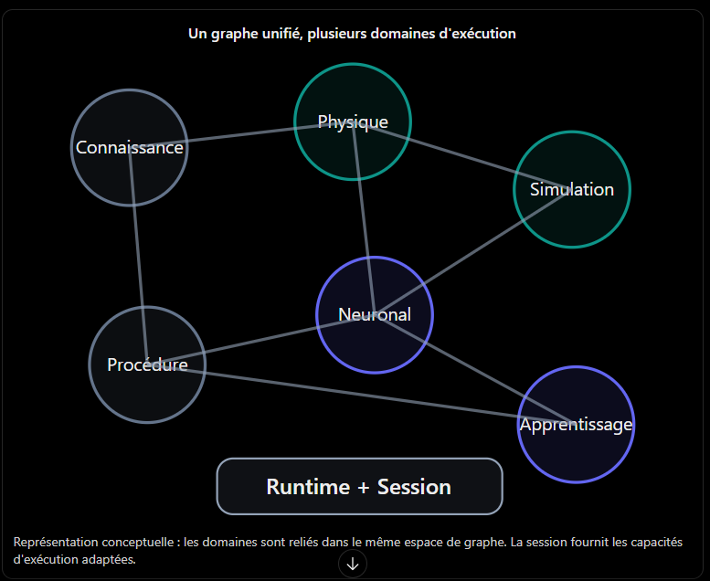

# Fondements de conception du harness industriel

Date : 10 octobre 2026.

Source : conversation transmise par l'utilisateur, initialement partagée à l'adresse <https://chatgpt.com/share/6aca14be-f37c-83ed-992b-52eba536b4d7>, et schéma joint. L'analyse porte sur le texte fourni, pas sur une éventuelle suite de la conversation. Le schéma se place dans la dernière réponse, sous « Un graphe unifié, plusieurs domaines d'exécution ».

## 1. Intention fondatrice et portée des conclusions

Le harness doit être conçu à partir du graphe comme fondement de la représentation et de l'exécution. L'objectif ne se réduit pas à produire des modules logiciels fonctionnels : chaque évolution doit préserver la cohérence de cette architecture.

L'utilisateur formule directement deux exigences :

- L'intégration du graphe est un élément fondateur, que les propositions de code doivent prendre en compte.
- Les graphes portent les éléments nécessaires à leur exécution avec un runtime ; la session, comprise comme contexte du runtime, transporte les données et contextes nécessaires, notamment un solveur physique et des contextes d'inférence ou d'apprentissage.

Il rejette explicitement une conception qui sépare les graphes en procédures isolées.

La conversation propose ensuite une lecture unifiée de ces exigences : un même espace de graphe compose des sous-structures typées, interprétées par le runtime avec les capacités et états de la session. Cette lecture sert ici de ligne directrice. Elle ne fixe pas encore les interfaces, le métamodèle ou les règles exactes de distribution.

Les mécanismes cités seulement par l'assistant, comme la factory, les agents contradicteurs, MCP, ONNX distribué ou OTA, restent des éléments à confirmer. Leur présence dans le dialogue ne constitue pas une validation explicite de leur implémentation par l'utilisateur.

## 2. Graphe, runtime et session : le contrat architectural

### Un espace de graphe composable

Connaissance, monde physique, simulation, procédures, inférence et apprentissage doivent pouvoir s'articuler dans une représentation cohérente. Les frontières de domaine ne doivent pas imposer, à elles seules, des programmes ou workflows isolés.

Une procédure, un modèle neuronal ou un jumeau numérique peuvent être décrits par des sous-graphes. Leur découpage doit permettre la composition, les relations entre domaines et la continuité d'exécution. Le partage de nœuds, l'extension et la fusion sont évoqués comme possibilités, dont les règles restent à définir.

Le schéma joint représente six domaines reliés dans le même espace : Connaissance, Physique, Simulation, Neuronal, Procédure et Apprentissage. « Runtime + Session » fournit le contexte d'exécution de cet ensemble. Les traits du dessin illustrent des relations conceptuelles : ils ne spécifient ni un ordre de parcours, ni des directions, ni un contrat d'API.

### Un runtime qui mobilise les capacités requises

Le runtime interprète les structures du graphe et mobilise les capacités nécessaires aux domaines rencontrés. L'arrivée dans une partie physique ou neuronale ne doit pas, par défaut, rompre le modèle d'exécution commun.

Des moteurs spécialisés restent possibles : solveur physique, moteur d'inférence ou autre service natif. La proposition du dialogue est de représenter leur identité, leurs capacités, leurs dépendances et leur articulation dans le graphe. Un composant externe doit donc avoir un rôle explicite dans ce modèle.

### Une session qui maintient la continuité du contexte

La session transporte les contextes et données nécessaires au parcours. Elle peut mobiliser plusieurs domaines simultanément ; le tableau suivant reprend les contextes proposés dans la dernière réponse, sans en faire une API déjà décidée.

| Domaine | Contexte proposé dans la session |
| --- | --- |
| Connaissance | Sources, versions, provenance, assertions |
| Physique | Solveur, paramètres, unités, contraintes |
| Simulation | État, conditions initiales, perturbations |
| Inférence | Moteur ONNX si retenu, tenseurs, état d'inférence |
| Apprentissage | Paramètres, gradients ou règles de plasticité selon le mécanisme retenu |
| Procédures | Autorisations, préconditions, traces d'exécution |

La session peut transporter des références ou handles vers des moteurs spécialisés ; le dialogue ne précise pas encore la forme de ces objets ni leur sérialisation. Il faut distinguer l'état durable du graphe de l'état propre à une exécution, sans perdre leur articulation.

Exemple de composition proposé : une simulation rencontre un nœud neuronal, réalise une inférence, transmet le résultat au solveur physique et poursuit l'évaluation. Ce scénario exprime une capacité recherchée, pas une fonctionnalité dont l'existence aurait été vérifiée dans le dépôt.

## 3. Invariants à suivre pendant la construction

Les invariants suivants traduisent l'intention de l'utilisateur et la synthèse architecturale du dialogue en règles de travail.

1. **Exprimer une évolution dans le graphe avant de coder.** Identifier les structures, relations et contextes concernés avant de proposer des classes ou services.
2. **Préserver la composition entre domaines.** Un découpage en sous-graphes ne doit pas suffire à créer des exécutions isolées.
3. **Maintenir la continuité de session.** Les informations nécessaires doivent rester accessibles au passage entre physique, simulation, inférence, apprentissage et procédure.
4. **Rendre les besoins d'exécution explicites.** Les capacités nécessaires doivent être résolubles à partir du modèle retenu. Le choix entre déclaration par le nœud et détermination par le resolver reste ouvert.
5. **Justifier les composants spécialisés.** Expliquer leur rôle et leur raccordement au graphe, ainsi que la raison pour laquelle les primitives existantes ne suffisent pas.
6. **Préserver la cohérence globale.** Une solution locale doit être évaluée pour ses effets sur les autres domaines et sur le contrat runtime/session.
7. **Garder les décisions révisables.** Une proposition de l'assistant ne devient pas une contrainte simplement parce qu'elle a déjà été formulée ou implémentée.

La conversation ne fournit pas un métamodèle complet. Ces règles ne doivent pas être utilisées pour inventer silencieusement de nouvelles primitives ou imposer une technologie non validée.

## 4. Processus de conception attendu avant chaque évolution

Le dialogue propose une étape préalable d'intégration au graphe. Chaque évolution devrait produire une courte fiche répondant aux questions suivantes.

| Question | Élément à expliciter |
| --- | --- |
| Quels nœuds ? | Types réutilisés ; justification des types nouveaux |
| Quelles relations ? | Liens typés, directions et contraintes |
| Quels resolvers ? | Évaluation ou exécution attendue ; capacités mobilisées |
| Quelle session ? | Données, états et contextes nécessaires ; continuité entre domaines |
| Quelle évolution du graphe ? | Transformations de topologie et éventuelles règles de promotion |
| Quelle persistance ? | État et expérience conservés ; articulation avec l'état de session |
| Quelle distribution ? | Sous-graphes exportables et conditions d'applicabilité, si ce besoin est confirmé |
| Quels invariants ? | Propriétés préservées et moyens de vérifier leur respect |

Pour une évolution difficile, commencer par une représentation de la transformation du graphe, sans raisonner d'abord en classes, services ou fichiers. Cette méthode sert à vérifier la compréhension de l'architecture avant de choisir l'implémentation.

Le cycle proposé dans la conversation est :

**Observation → graphe → raisonnement → transformation topologique → exécution → expérience → évolution du graphe.**

Ce cycle est une proposition structurante de l'assistant. Les conditions précises de mutation, d'apprentissage et de promotion restent à définir.

## 5. Exigences de validation pour le harness industriel

Les points suivants sont des recommandations déduites des principes précédents. Ils ne constituent ni des résultats de tests, ni des exigences réglementaires établies par la conversation.

- Vérifier un parcours composé qui passe d'une simulation à une inférence puis à un calcul physique, avec transmission effective des résultats et maintien du contexte nécessaire.
- Vérifier que le découpage logique en sous-graphes préserve la composition et n'introduit pas de remise à zéro involontaire de la session.
- Définir le comportement en cas de capacité absente ou incompatible : détection, trace et traitement explicite avant une exécution qui en dépend.
- Définir la portée et la durée de vie des états de session, notamment pour éviter le mélange involontaire entre exécutions distinctes.
- Vérifier l'effet des transformations topologiques sur les dépendances et les invariants, si ces transformations sont retenues.
- Si la distribution est retenue, vérifier les conditions de reconstitution du contexte et d'applicabilité d'un sous-graphe exporté.

Les contraintes physiques et les règles de sûreté sont mentionnées par l'assistant, mais leurs limites concrètes, leurs autorités et leurs modes de contrôle ne sont pas spécifiés. Le passage au pilotage industriel exige de les formaliser avant de conclure à l'aptitude opérationnelle du système.

Le dialogue suggère aussi de conserver durablement les décisions d'architecture, les invariants et les résultats de tests, afin que la conception ne dépende pas seulement du contexte temporaire d'un assistant. Ce document constitue un premier support de cette mémoire, sans décider de son implémentation dans le produit.

## 6. Questions techniques encore ouvertes

1. **Métamodèle :** quelles sont les primitives universelles exactes, leurs types et leurs règles de composition ? La conversation pose la question sans fournir de réponse.
2. **Déclaration des capacités :** le nœud déclare-t-il ses besoins, ou le resolver associé à son type les détermine-t-il ? C'est la dernière question du texte transmis.
3. **Cycle de vie de session :** comment les contextes sont-ils acquis, partagés, libérés, sauvegardés et repris ?
4. **État durable et état d'exécution :** quelles données appartiennent au graphe, à la session ou aux moteurs spécialisés ?
5. **Topologie :** quelles transformations sont autorisées et quelles règles encadrent partage, extension, fusion et promotion ?
6. **Exécution :** quelles règles gouvernent l'ordre, la concurrence, les erreurs et les effets externes ? Le schéma ne les détermine pas.
7. **Distribution :** quels contextes sont transportables et quelles capacités doivent être retrouvées sur le runtime destinataire ?
8. **Périmètre produit :** quels rôles sont réellement retenus pour MCP, les contradicteurs, la factory, ONNX, la mémoire persistante et OTA ?

## 7. Point d'attention dans le dépôt actuel

Le [README du prototype archivé](../archive/exploration-2026-10-10/README.md), dans « Overview », présente trois graphes : plant, harness et policy. La conversation demande précisément de ne pas concevoir les graphes comme des procédures isolées.

Cette formulation mérite une clarification : trois sous-graphes logiques dans un espace composable peuvent respecter l'intention ; trois modèles d'exécution indépendants qui rompent la continuité du runtime et de la session peuvent la contredire. La lecture du README ne suffit pas à déterminer le comportement réel de l'implémentation.

Ce document pose donc une référence de conception issue de la conversation. Il ne constitue pas un audit du code ni une validation des fonctionnalités existantes. La prochaine revue d'architecture devra confronter le métamodèle et le contrat runtime/session actuels à ces fondements.
