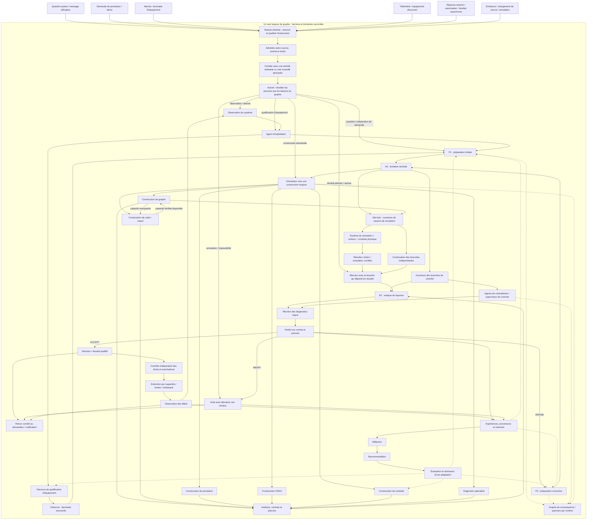
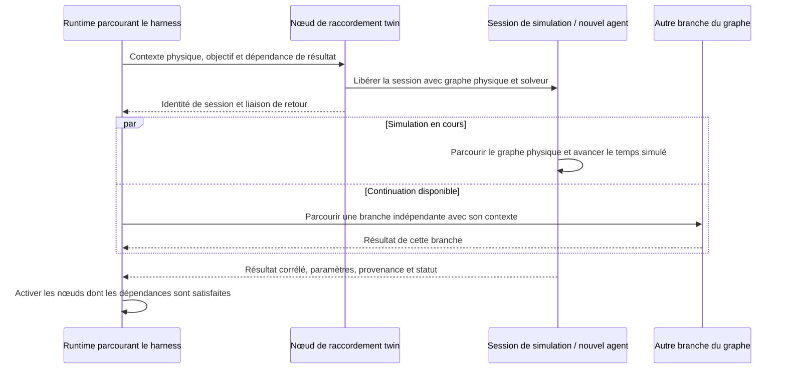

# Représentation du graphe unifié du harness

Date : 10 octobre 2026.

## 1. Point de départ confirmé par l'utilisateur

**Le harness EST le graphe avec ses runtimes.** L'orchestration résulte du parcours et de l'activation de ses nœuds et relations. Les contextes sont portés par les runtimes et leurs sessions.

La représentation concerne le harness générique. Elle reprend sa base éprouvée et ses évolutions, ainsi que les acquis exploratoires à réexaminer pour l'apprentissage. L'application qui a servi à ces expérimentations ne définit pas les noms ou les rôles du harness.

Le fonctionnement pas à pas examiné précédemment est une facilité de debug. Il ne définit pas le fonctionnement standard recherché et ne doit pas être interprété comme une obligation de fermer tout le contexte après chaque action.

Cette représentation est la première étape, avant le plan d'évolution et l'implémentation. Elle rassemble les rôles du harness et les raccordements demandés dans un même espace de graphe. Elle ne prétend pas que le code actuel exécute déjà toutes ces liaisons ni que les primitives de concurrence proposées sont déjà disponibles.

Références : [fondements](fondements-harness-industriel.md), [analyse du brief](analyse-brief-boucles-cognitives-co2-scrubber.md). Les précisions de l'utilisateur reprises ici gouvernent l'interprétation des deux notes antérieures.

## 2. Ce qui constitue un agent dans cette représentation

Un agent est une activité de parcours et d'exécution du graphe, portée par un runtime et son contexte de session. Il peut observer, rechercher des connaissances, analyser, construire un prompt, contredire une hypothèse, construire un artefact, simuler ou apprendre.

Un appel LLM est une capacité mobilisable pendant ce parcours. Il n'est pas nécessaire à l'existence de chaque agent. Un runtime qui parcourt la connaissance ou exécute une simulation est également un agent dans le sens précisé par l'utilisateur.

Les régions ci-dessous désignent des sous-structures composables, pas des programmes isolés. Une région peut être parcourue par plusieurs sessions ; une session peut rencontrer plusieurs régions. Les limites de processus ou les transports MCP n'imposent pas une rupture de représentation.

## 3. Inventaire des régions à raccorder

« Base existante » désigne un mécanisme identifié dans l'implémentation de référence. « À représenter » signifie une responsabilité demandée dont la forme générale n'a pas encore été identifiée comme livrée. Les points de reprise techniques sont regroupés dans la note de provenance.

| Région du graphe commun | Statut de reprise | Fonction et contexte principal |
| --- | --- | --- |
| Déclencheurs externes et points d'entrée | Interfaces et transports existants à raccorder | Question, demande, alarme, événement ; admission, corrélation et activation dans le graphe |
| Entrées et observation du système | Base existante | État observé, équipement, événement et objectif |
| Agent d'exploitation | Base existante | Interprétation de la situation, objectifs et demandes de capacités |
| Observation et formulation de demande | Base existante | Description, télémétrie, connaissances, demande de jumeau |
| Préparation initiale P1 | À représenter ; réutiliser les mécanismes d'observation et de contexte | Recherche, découverte et construction du premier prompt suffisant |
| Agent central A0 | Capacité de raisonnement existante à raccorder | Tentative de résolution, demandes d'outils, réponse originale |
| Analyse de réponse R1 | À généraliser depuis validations, évaluateurs et superviseur | Diagnostic de forme, de sens et de preuves |
| Contradiction | Base partielle : superviseur de contrats | Contestation des affirmations, contradictions et preuves manquantes |
| Préparation corrective P2 | À représenter depuis diagnostics et reprises existants | Recherche complémentaire et nouvelle sollicitation de A0 |
| Construction de graphe | Base existante | Composition, paramètres, évaluation et contrat d'un graphe |
| Construction de code/nœuds | Base existante | Capacité absente, construction, vérification, proposition de nœud |
| Construction de procédure | Base existante | Procédure, préconditions, justifications et contraintes |
| Construction ONNX | Base existante | Apprentissage/ajustement de modèle, contrat et artefact |
| Construction de conduite | Base existante | Graphe de conduite et contrôles associés |
| Diagnostic | Base existante | Hypothèses, symptômes, observations et diagnostic |
| Réflexion | Base existante | Expériences, motifs de difficulté et adaptation proposée |
| Recommandation | Base existante | Modification proposée, justification et vérification |
| Conduite des parcours | Base existante | Relations de progression, preuves, activation et fermeture de capacités |
| Qualification d'équipement | Parcours existant à généraliser | Qualification, essais, reprises, construction et proposition de jumeau |
| Parcours des connaissances | Base existante ; activité de runtime à expliciter | Graphe de connaissance, sources, faits, unités et règles |
| Simulation | Base existante ; raccordement concurrent à expliciter | Graphe physique, solveur, temps simulé, conditions initiales et observations |
| Mémoire et apprentissage | Recettes, épisodes et graphes d'analyse existants | Expériences, corrections, contexte d'applicabilité et historique |
| Autorité et exécution | Gardes du harness, politiques du broker, contrôle embarqué | Droits, autorisations, effets et observations réelles |
| Retour au demandeur et notifications | Interfaces de dialogue et de suivi des tâches à raccorder | Réponse, procédure proposée, état d'avancement, refus ou arrêt ; lien à l'événement d'origine |
| Capacités et transports | Catalogue MCP, broker, workspace, web, reasoner, forge, model | Ressources mobilisées par les sessions, contrats et identités |

Les neuf spécialités de construction identifiées sont observation, graphe, code, procédure, modèle ONNX, conduite, diagnostic, réflexion et recommandation. L'Observer apparaît aussi dans la préparation, car il s'agit de deux usages d'une région existante à composer, pas d'une nouvelle copie de son implémentation.

Les interfaces de dialogue, équipements, ressources d'observation et moteurs spécialisés restent raccordés selon leurs capacités. Leur existence ne signifie pas que chacun possède un harness cognitif distinct. Il faut distinguer les agents et les capacités qu'ils rencontrent.

## 4. Graphe d'ensemble

Les flèches pleines ci-dessous représentent des passages de contexte, des demandes ou des résultats à rendre explicites. Les flèches pointillées représentent un accès ou un rattachement. Le schéma est une topologie cible, pas un relevé de dépendances de fonctions TypeScript.

Une flèche n'implique pas que tous les événements doivent emprunter cette branche. Les conditions d'activation, les dépendances et les sorties alternatives doivent appartenir au graphe. L'orientation ne doit pas être décidée par un contrôleur métier caché derrière le dessin.

R1 et les contradicteurs peuvent fonctionner en parallèle sur une même tentative. Le diagnostic ne peut être réuni qu'après réception des contrôles requis par son contrat. Une réponse de construction peut aussi passer par ses propres validations avant de rejoindre l'analyse commune. La qualification d'équipement conserve ses préconditions et étapes spécifiques dans cette topologie.

### 4.1. Les déclencheurs externes sont des entrées actives du graphe

Le harness doit pouvoir être activé par son environnement, et pas seulement par une intention fournie à un agent déjà lancé. Chaque point d'entrée reçoit un événement, établit sa provenance et son contrat, puis active les relations correspondantes. Réception, qualification, admission et corrélation sont elles-mêmes représentées dans le graphe ; le transport fournit l'événement au runtime.

| Déclencheur externe | Parcours activable | Contexte apporté ou retrouvé |
| --- | --- | --- |
| Question posée, par texte, voix ou API | Préparation P1, parcours de connaissance, A0 et validation selon le besoin | Question originale, interlocuteur, échange référencé, équipement ou domaine, destination de réponse |
| Demande de création ou révision d'une procédure | Préparation de demande et région de construction de procédure, puis contrôles et proposition | Objectif, équipement, procédure existante éventuelle, version, contraintes, livrable attendu et droits |
| Alarme ou anomalie | Observation, analyse/diagnostic, contradiction, recherche de preuves ou simulation | Source de l'alarme, identité de l'incident, gravité, temps d'observation, mesures et règles applicables |
| Télémétrie nouvelle ou franchissement de condition | Mise à jour des observations et activation des branches dont les conditions sont satisfaites | Mesures, unités, qualité, horodatage, équipement, version de l'état |
| Équipement ou capacité découvert, modifié ou indisponible | Agent d'exploitation ; il engage le parcours de qualification d'un équipement, ou la vérification de capacités et la réévaluation des tâches concernées | Identité, contrat, capacités, version et conditions de disponibilité |
| Réponse à une question en attente | Réveil du parcours concerné, nouvelle préparation ou poursuite de construction | Identifiant de question, réponse, auteur et session demandeuse |
| Autorisation accordée, refusée ou retirée | Réveil du point d'attente ou arrêt de la branche ; contrôle des droits avant l'effet | Autorité signataire, opération, portée, validité et référence de demande |
| Résultat ou échec d'une activité distante | Publication sur la liaison de retour et activation des dépendants | Session productrice, tentative, résultat, provenance et statut |
| Échéance, surveillance périodique ou délai expiré | Observation prévue, reprise ou arrêt selon les relations du graphe | Condition temporelle, activité ciblée, budget et motif |
| Source de connaissance corrigée ou invalidée | Réévaluation des hypothèses, preuves et parcours qui en dépendent | Source, versions, correction et relations de dépendance |
| Annulation ou modification d'une demande | Arrêt ciblé ou création d'une nouvelle version de l'objectif | Auteur, demande/session ciblée, portée du changement et contexte conservé |

Ces parcours sont conditionnels. Une question documentaire peut mobiliser directement un parcours de connaissance ; une demande de procédure peut activer la construction si son contexte est déjà suffisant. Les déclencheurs ne sont pas tous forcés à passer par l'agent d'exploitation, A0 ou la même chaîne de préparation.

La qualification d'un équipement passe par l'agent d'exploitation. Celui-ci reçoit l'événement et son contexte, puis engage le parcours de qualification approprié dans le graphe. Le déclencheur n'active pas directement ce parcours.

La région d'activation indique conceptuellement trois possibilités : créer une activité avec son contexte initial, réveiller une activité qui attend cet événement, ou publier une observation à plusieurs activités intéressées. Les abonnements et les conditions d'activation doivent être des relations inspectables du graphe. Un événement peut activer plusieurs parcours en parallèle.

L'enveloppe d'événement doit identifier au minimum l'événement, son type, sa source, son contenu ou sa référence et son temps d'observation. Selon le cas, elle porte aussi le demandeur, l'équipement, la corrélation avec une tâche/session/question, la version attendue et la destination de retour. Le contexte est construit ou retrouvé par le runtime à partir de cette enveloppe et des relations du graphe.

La redélivrance d'un même événement ne doit pas dupliquer un effet. En revanche, une nouvelle mesure ou une répétition réelle d'alarme ne doit pas être perdue comme un doublon de transport. Un retour tardif destiné à une tentative annulée ou remplacée doit être tracé et traité selon son contrat, sans satisfaire silencieusement une attente plus récente.

La priorité d'une alarme et ses règles de poursuite, suspension ou annulation doivent être explicites. Les protections déterministes du système restent actives indépendamment du parcours cognitif ; l'analyse d'une alarme ne doit pas devenir une condition préalable à leur fonctionnement. Une activation de parcours ne confère pas, à elle seule, l'autorisation d'une action physique.

Le retour au demandeur appartient également au graphe : réponse à la question, proposition de procédure, état d'attente, notification d'alarme ou arrêt motivé. Il conserve le lien à l'événement d'origine. Une procédure construite et validée peut être remise comme proposition ; son exécution éventuelle reste un parcours autorisé distinct.

## 5. Le flow commun du harness reste visible dans le graphe

Le flow V1 constitue le motif existant à reprendre pour les régions qui l'utilisent :

```mermaid
flowchart LR
  O["Observer"] --> CT["Construire le contexte"]
  CT --> L["Consulter la mémoire"]
  L --> G["Évaluer l'applicabilité"]
  G -->|"expérience applicable"| M["Sélectionner la décision"]
  G -->|"raisonnement requis"| P["Préparer la sollicitation"]
  P --> R["Mobiliser le modèle"]
  R --> M
  M --> A["Contrôler l'autorité"]
  A --> X["Exécuter la capacité"]
  X --> OA["Observer le résultat"]
  OA --> EV["Évaluer"]
  EV --> REC["Enregistrer l'expérience"]
```

Ce motif doit pouvoir être instancié avec les nœuds, relations et contextes propres à chaque rôle, dans le même graphe logique. Représenter un rôle par une boîte dans le schéma d'ensemble sert à la lecture ; l'implémentation devra exposer la région correspondante, ses entrées, sorties et relations internes. Une boîte qui ne ferait qu'appeler une procédure opaque ne suffirait pas.

La conduite, les contrôles, la préparation et la contradiction doivent être raccordés à ce motif selon leurs contrats. L'ordre réel doit provenir des relations du graphe, y compris pour les reprises et les dépendances entre constructions.

## 6. Passage des contextes en série et en parallèle

Les noms ci-dessous sont des responsabilités à formaliser dans les primitives du runtime existant, pas des API déjà choisies.

| Passage dans le graphe | Effet sur l'activité du runtime |
| --- | --- |
| Liaison en série | Transmettre le contexte utile et les résultats au prochain nœud activable |
| Ouverture de branches | Libérer plusieurs activités/session de parcours corrélées, avec les contextes nécessaires |
| Rencontre d'un domaine spécialisé | Mobiliser la capacité requise et enrichir le contexte, par exemple un solveur pour la simulation |
| Liaison de retour | Publier résultat et provenance vers les nœuds dépendants, avec l'identité de l'activité productrice |
| Réunion de branches | Attendre seulement les résultats exigés par les dépendances du graphe |
| Pause pour autorisation ou donnée externe | Suspendre l'activité concernée ; laisser progresser les branches indépendantes |
| Arrêt ou annulation | Clore l'activité et ses ressources selon le contrat, publier son statut aux dépendants |

Un contexte peut comprendre : objectif, contraintes, références de connaissance, observations, hypothèses, contrat, modèle, solveur, état d'inférence ou d'apprentissage, droits, budgets et corrélations d'exécution. Les handles vivants de moteur ou de transport appartiennent au contexte d'exécution ; leurs identités et contrats restent représentés dans le graphe.

En parallèle, les sessions doivent conserver leur identité et éviter les mutations concurrentes implicites d'un même état. Les résultats destinés à une réunion doivent référencer la même tentative, les versions pertinentes et la branche d'origine. Le choix entre partage contrôlé, projection ou copie de données sera défini selon les contrats du runtime, sans imposer un mécanisme uniforme à tous les domaines.

L'activité appelante n'a pas à attendre toute session lancée. Une attente existe lorsqu'une liaison déclare une dépendance de résultat. Une autre branche peut progresser tant que ses entrées sont disponibles.

## 7. Exemple fondateur : rencontrer le slot twin

Ce schéma traduit directement la clarification de l'utilisateur. La session de simulation devient un agent jusqu'à sa fin. Elle n'a pas besoin d'un LLM pour simuler. Le runtime du harness peut poursuivre son parcours pendant cette activité.

La base existante fournit le graphe physique, ses exécutions et la surface de runtime du slot twin. L'ouverture non bloquante et le retour explicite dans le graphe commun restent des contrats à vérifier et à raccorder. Un calcul synchrone qui monopolise le thread appelant ne suffit pas à démontrer la progression concurrente. L'exécution devra s'appuyer sur les possibilités réelles des runtimes, sans créer un second orchestrateur métier.

## 8. Le parcours de connaissance suit le même principe

Quand une activité rencontre la région de connaissance, un runtime la parcourt avec son contexte : question, types recherchés, domaine d'application, sources admissibles et preuves attendues. Il produit des références et résultats traçables qui rejoignent les régions de préparation, de contradiction ou d'analyse.

La connaissance reste un graphe. Le document lu ou le prompt construit en est une projection destinée à une étape donnée. Une recherche textuelle, un transport MCP ou un stockage de documents peuvent être des capacités utilisées pendant le parcours ; ils ne remplacent pas sa sémantique de graphe.

La base existante expose déjà des parcours du graphe de connaissance ; la bibliothèque fournit des sources, faits et signatures. Leur raccordement comme activités de runtime dans l'espace commun doit être explicité. Il ne faut pas prétendre que les appels de lecture actuels réalisent déjà tout ce contrat.

## 9. Contrat architectural pour la suite

1. Toute région agent possède une représentation de graphe, avec des relations de contexte et des conditions d'activation explicites.
2. L'exécution, la reprise, l'attente et le parallélisme appartiennent aux runtimes du graphe et aux contrats de leurs sessions.
3. Les transitions P1/A0/R1/P2, les contradictions et les hand-offs entre factories sont des relations du graphe.
4. Un moteur spécialisé est mobilisé dans le contexte du parcours qui en a besoin ; ses résultats reviennent par des liaisons identifiées.
5. Les contextes restent continus par des transmissions explicites ; leur distribution ne les transforme pas en mémoires conversationnelles isolées.
6. La connaissance, les preuves, les expériences et leurs relations restent accessibles dans le même espace logique.
7. Un agent peut être déterministe, physique, neuronal ou fondé sur un LLM. Son autorité découle de son contexte et des contrôles indépendants.
8. Le mode debug observe ou suspend le même flow. Il ne constitue pas une orchestration différente du fonctionnement standard.
9. La représentation initiale doit être confrontée aux primitives réelles de Core : programmation des événements, création des sessions, passage des contextes, reprises et raccordements distribués.
10. L'apprentissage fera évoluer des structures et leur applicabilité selon des règles contrôlées, après consolidation de la base du harness. Il ne doit pas servir à masquer un raccordement incomplet.
11. Les déclencheurs externes, abonnements, reprises et retours au demandeur sont des nœuds et relations du graphe ; leur priorité et leur corrélation sont portées par les contrats de runtime/session.

## 10. Premier livrable à construire à partir de cette représentation

La prochaine étape est une définition complète et inspectable du graphe : identifiants des régions et nœuds, liens typés, contrats de contexte, conditions de branchement et de réunion, régions parcourues et points de retour. Elle devra déplier les boîtes de cette carte et les faire correspondre aux classes et primitives existantes.

Le premier scénario de vérification sera un parcours qui prépare une demande, ouvre une simulation et une recherche de connaissance en parallèle, poursuit une branche indépendante, réunit les preuves requises, puis fait intervenir analyse et contradiction. Une insuffisance devra activer P2 et une nouvelle tentative dans le même espace de graphe.

Ce parcours devra être démarré depuis un véritable point d'entrée externe. Les variantes couvriront une question posée, une demande de procédure et une alarme arrivant pendant une simulation. Il faudra vérifier le réveil d'une session en attente, le retour corrélé au demandeur, l'absence de double effet après redélivrance et le traitement d'un résultat tardif après annulation.

Le plan d'évolution viendra ensuite : il devra indiquer, pour chaque région, ce qui est repris de la base existante, ce qui est raccordé et ce qui nécessite une extension des primitives du runtime. Ce document ne lance ni extraction de code, ni refactorisation, ni nouvelle exécution du harness.

## 11. Note de provenance technique

L'implémentation examinée se trouve dans `co2-scrubber-governed-agent`, où la base extraite du harness a évolué et a été éprouvée selon les précisions de l'utilisateur. Ce nom désigne le dépôt source de la reprise, pas une région ni une spécialisation obligatoire du harness générique.

Points de reprise dans ce dépôt :

- Flow commun et sessions : `harness/lib/flow.ts`, `harness/core/agent.ts`, `harness/core/runner.ts`, `harness/core/conduct.ts`.
- Exploitation et observation : `tier3/agent.ts`, `tier3/lib/observer.ts`, `slots/agent/provider.ts`, `harness/observer/observer.ts`, `harness/topics/observer/index.ts`.
- Contradiction et contrôles : `harness/supervisor/supervisor.ts`, `harness/core/contracts.ts`, `harness/core/interpreter.ts`.
- Spécialités de construction : `harness/topics/{graph,code,procedure,onnx,playbook,diagnosis,reflection,recommendation}/index.ts`, en complément du sujet observer.
- Qualification d'équipement : `slots/scenario/commissioning.ts` et son graphe de conduite.
- Connaissance et simulation : `slots/physics/provider.ts`, `slots/tools/library/provider.ts`, `slots/twin/provider.ts`, `slots/twin/cabin-twin.ts`, `lib/habitat.ts`.
- Mémoire et expériences : recettes et épisodes, `lib/memory.ts`, `lib/harness-graph.ts`.

Ces chemins servent à retrouver les mécanismes avant leur reprise ; leurs noms applicatifs ne définissent pas le vocabulaire de la représentation.
