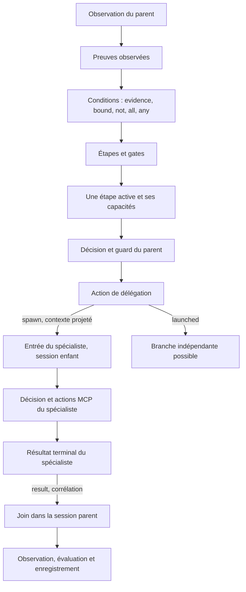

# Conduite et délégation dans le graphe commun

Date : 6 novembre 2026. Deuxième lot de reprise du démonstrateur CO₂.

## Ce qui est exécuté

`src/graphs/agents.json` contient les régions de décision du parent et du spécialiste, le circuit de conduite, le nœud de délégation et le join. Une seule instance Core `RuntimeGraph` est chargée par la factory native. Les sessions du parent et de ses enfants référencent cette même instance ; aucun sous-graphe indépendant n'est reconstruit pour l'enfant.

L'hôte démarre `graph.runAsync(0, session)`. Les nœuds et liens définissent les étapes et la délégation. Il n'existe pas de contrôleur de tâches extérieur qui déroule le travail. `createDelegateServices` rattache seulement les services et l'identité du rôle demandé ; il ne lance pas l'agent.



Les liens `spawn` et `result` sont des `DelegationLink`, spécialisés de `Channel` à travers `HarnessLink`. Leur champ `delegateId` lie le point d'entrée du spécialiste à son retour. Le nœud de délégation injecte le token dans les buffers natifs de l'enfant, puis appelle le runtime Core sur cet enfant. Le résultat revient dans la file native du parent par le lien déclaré.

## Reprise critique de la conduite

Le scrubber possédait déjà des nœuds `conduct.start/evidence/bound/not/all/any/stage/gate`, mais construisait un graphe séparé et une nouvelle session à chaque évaluation. Le présent lot reprend leurs responsabilités dans le graphe commun, par les registres et la matérialisation JSON actuels. Il ne copie pas le lecteur de playbook ni le builder historique.

`conduct.ingress` demande une photographie des preuves au service d'observation. Les nœuds de conditions opèrent sur ces données et leurs liens. `conduct.commit` attend les contributions des étapes et des gates, vérifie une seule étape active, puis enregistre le snapshot dans la session et transmet le token à la décision.

Les preuves peuvent être vraies, fausses ou inconnues. Une preuve inconnue reste `null`. Les combinaisons respectent cette distinction ; une gate inconnue ferme les capacités concernées. Une étape qui attend une preuve manquante reste active. Le guard vérifie les capacités de cette étape même pour une décision déterministe, et le reasoner reçoit seulement les capacités actuellement ouvertes.

La photographie vient des observations et résultats vérifiables de l'application. Le texte d'une réponse du modèle ne constitue pas automatiquement une preuve. Les traces conservent les faits lus, les conditions, l'étape active, les fermetures et leurs raisons.

## Sessions et corrélations

`AgentSession` spécialise `DecisionSession`, elle-même spécialisée de `Session` Core. La portée accessible se déduit des liens de continuation depuis l'entrée de cette session. Les transitions de délégation ouvrent un autre contexte ; les retours rendent le join accessible dans le contexte du parent. Cette portée est un ensemble de références vers les nœuds existants, pas une copie du graphe ni un ordonnanceur.

Chaque tentative porte parent, enfant, rôle, profondeur, numéro d'itération et identifiant de tentative. Le rôle, les clés de projection du contexte et la profondeur maximale sont déclarés dans le JSON. L'enfant reçoit uniquement cette projection et le contexte explicite de la demande autorisée par le guard. Cela évite une copie implicite du contexte parent ; le guard reste responsable du contenu que l'agent propose explicitement de transmettre.

Le service d'attachement doit fournir une session MCP `_broker` distincte pour l'enfant. Le harness ne lui attribue pas de droits et ne copie pas les credentials du parent. Le broker applique les politiques de l'identité choisie par l'hôte. Un test HTTP avec un vrai broker montre qu'un spécialiste peut être refusé alors que son parent est autorisé.

Le lien de résultat rejette les mauvais destinataires, tentatives périmées et doublons avant leur mise en buffer. Le join utilise le rapport réellement produit par l'enfant, conservé dans la session parent. Il ne fait pas confiance à un rapport arbitraire reçu dans un token. Cette protection porte sur la vie de la session en mémoire ; elle n'est pas une garantie de livraison exactement une fois après redémarrage.

Un enfant terminé sans objectif satisfait reste un résultat d'échec pour l'action déléguée. Un refus du broker ne devient jamais un succès. La terminaison de l'enfant ne termine pas automatiquement la mission du parent. L'annulation descend dans les sessions enfants ; une requête MCP déjà en vol reste soumise aux garanties et délais de son transport.

## Concurrence native

Core dispose désormais du mode optionnel `RuntimeNode.asyncMode = "concurrent"`. Le nœud de délégation utilise ce mode. Le parcours dynamique natif garde la propriété des opérations en cours, traite les tokens publiés pendant leur attente et attend leur terminaison avant de rendre la main. Un abonnement à la file native réveille le parcours lorsqu'un nœud publie avant la fin de son opération.

Le mode par défaut reste bloquant. Un même nœud n'a pas deux activations concurrentes dans une même session ; les tokens supplémentaires restent dans ses buffers. D'autres nœuds de la session et d'autres sessions peuvent progresser. Les erreurs ne laissent pas d'opérations concurrentes admises vivre hors du parcours. Aucun moteur de promesses propre au harness n'est ajouté autour de Core.

Cette concurrence est coopérative et asynchrone. Elle ne parallélise pas un calcul synchrone long sur le thread JavaScript. L'annulation et la réconciliation de branches multiples, les joins de plusieurs spécialistes et la distribution sur plusieurs hôtes demandent encore leurs propres contrats et preuves.

## Slots de la reprise

La [liste des slots et de leurs statuts](slots-reprise.md) distingue les providers consommables, les surfaces applicatives à extraire et les services de stockage à qualifier. Le présent lot n'installe ni ne publie automatiquement de nouveaux providers.

Les rôles `agent` et `factory` ne justifient pas de reprendre le runner `runTask` du démonstrateur : il déroulerait un autre contrôle d'exécution. Leur future façade MCP devra exposer les sessions et parcours de ce graphe.

## Vérification et limites

Les tests du harness couvrent le changement d'étape, les preuves inconnues, les gates et bornes, une conduite invalide, la projection du contexte, la portée du spécialiste, les corrélations, les retours tardifs et dupliqués, les erreurs et l'annulation descendante. Une branche indépendante du parent progresse effectivement pendant un appel MCP bloqué chez l'enfant.

Le premier lot de tests continue de couvrir découverte, résultats MCP, ruptures, budget et matérialisation. Les providers de test sont contrôlés. Aucun modèle distant ni équipement n'est appelé. Les cinq tests précédents de Core sont complétés par la publication avant fin d'une opération concurrente, la conservation des tokens et la terminaison des opérations admises après erreur.

Les trois échecs historiques de Core identifiés au premier lot restent préexistants et hors de cette modification. La persistance des missions, la restauration de sessions, les attentes humaines durables et l'exécution distante ne sont pas implémentées ici. L'apprentissage topologique reste archivé et exploratoire.

## Utilisation

```ts
import { AgentGraphFactory, AgentSession, buildAgentGraph } from "./dist/index.js";

const graph = buildAgentGraph(new AgentGraphFactory());
const parent = new AgentSession(graph, input, services);
try {
  await graph.runAsync(0, parent);
  console.log(parent.report);
} finally {
  parent.dispose();
}
```

Le contrat `IDecisionServices` ajoute `conductEvidence` et `createDelegateServices`. Le second retourne des opérations et clients MCP propres au rôle de l'enfant, avec son signal d'annulation. La session enfant choisit son entrée à partir du lien `spawn` du graphe. Les services de classe conservent leur objet récepteur lorsqu'ils sont rattachés à l'enfant.
