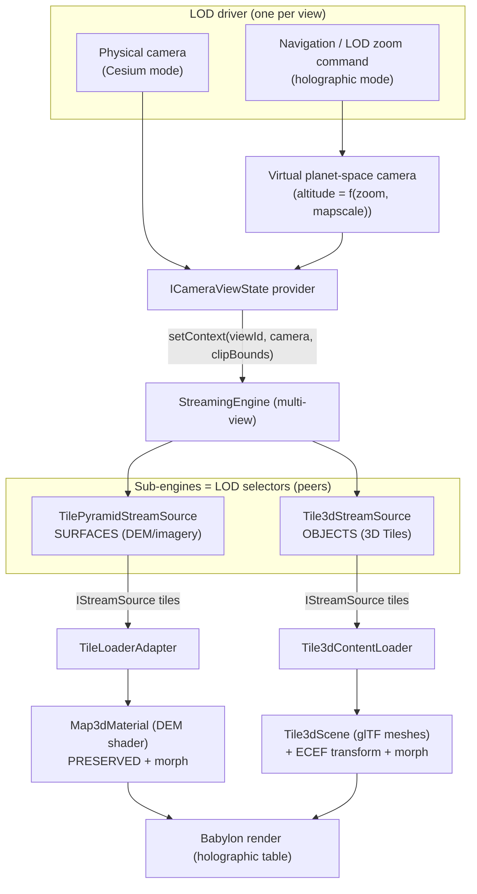

# 3D Tiles + Unified LOD Engine: implementation plan

> Status: Phase 0 and Phase A.1-A.5 implemented (see section 8). Last updated 2026-07-18.
>
> Goal: support OGC 3D Tiles as **one particular implementation** of a generic
> Level-of-Detail (LOD) engine that can *coalesce / decoalesce* both **surfaces**
> (worldwide DEM) and **objects** (3D Tiles), while preserving the custom DEM
> shader and the holographic-table navigation. Path: first reach exact 3D Tiles
> support with Cesium-like navigation, then evolve toward the holographic view
> (a planetoid floating over the table that flattens onto it as you zoom).

---

## 1. The one idea

The repository already contains, in `core`, a modern generic LOD engine
(`StreamingEngine` + `IStreamSubEngine` + SSE policy + budget). It is
engine-agnostic and multi-view. **3D Tiles is not a new engine; it is a new
sub-engine plugged into that one.** Surfaces (the DEM tile pyramid) and objects
(3D Tiles) become peer sub-engines feeding a single *cut*. Refining a cut is
"decoalesce"; coarsening it is "coalesce". The physical camera drives that cut in
Cesium mode; a **virtual camera synthesized from the LOD zoom command** drives it
in holographic mode. The renderer (DEM shader for surfaces, glTF meshes for
objects) is downstream of the cut and is preserved as-is, then extended with a
sphere-to-plane morph for the table.

This maps directly onto the existing 2D contract. Today:

| Concept | 2D legacy (live, drives the DEM) | Modern generic (built, not yet wired) |
|---|---|---|
| Selector | `TileView extends SourceBlock<ITile2DAddress>` | `IStreamSubEngine extends SourceBlock<T> + IStreamEngine` |
| Drive call | `setContext(navState, display, metrics)` | `setContext(viewId, cameraViewState, clipBounds)` |
| Emits | tile addresses (`ITile2DAddress`) | stream sources (`IStreamSource<T>`) |
| LOD rule | flat rectangle at integer LOD | quadtree + screen-space error + hysteresis |
| Surface impl | `TileView` | `TilePyramidStreamSource` |
| Object impl | (none) | **`Tile3dStreamSource` (to build)** |

`TilePyramidStreamSource` is already "`TileView` re-expressed as an SSE
sub-engine". `Tile3dStreamSource` is the 3D-Tiles peer of the same contract. That
is the "turn `TileView` into a specific implementation for 3D Tiles" seam, taken
to its natural conclusion.

---

## 2. Where the code stands today (grounded map)

### 2.1 Core, generic LOD engine (`core/src/streaming/`): solid, unwired to Babylon
- `StreamingEngine` (`streaming.engine.ts`): multi-view (`setContext(viewId, camera, clipBounds)`), octree traversal, `refinePQ` / `coarsenPQ`, per-frame refine/coarsen budgets, min-age anti-oscillation, and **sub-engine composition** (`IsStreamSubEngine` sources get `activate/setContext/deactivate` per view). `_traverse` is `protected` and overridable.
- `IStreamSubEngine` (`streaming.subengine.interfaces.ts`): a source that is also an engine. The composition primitive.
- `MapOverflightVisibilityPolicy` (`streaming.visibility.overflight.ts`): frustum + horizon cull, altitude-driven SSE budget, hysteresis; plane or sphere mode.
- `IScreenSpaceErrorBudget` (`streaming.visibility.budget.ts`): `getMaxSSE(altitude)`; Constant / Stepwise / PiecewiseLinear. The scalar it receives is *labelled* altitude but is just a number: the holographic hook.
- `TilePyramidStreamSource` (`tile/tile.pyramid.stream.source.ts`): the surface sub-engine. Walks its own quadtree (flat point-XY **or** ECEF via `Ellipsoid`), emits `TileStreamSource` children. Camera altitude drives the SSE budget.
- Adapters: `TileLoaderAdapter` (bridges to existing `ITileLoader`), `StreamSourceContentAdapter` (unwraps `content`).

### 2.2 Core, 3D Tiles standard (`core/src/tiles/3d/`): rich schema, standalone engine
- Full OGC 3D Tiles 1.1 schema as TypeScript types (interfaces): tileset, tile, bounding volumes, contents, implicit tiling, subtrees, tile formats (b3dm/i3dm/pnts/cmpt feature tables), schema/metadata, styling, statistics.
- `Tile3dStreamEngine` (`engine/tile3d.stream.engine.ts`): a **standalone** engine (not an `IStreamSubEngine`). Works: root init, parent linking, `worldTransform = parent * local`, ADD/REPLACE refine, box bounding volume, external `.json` tilesets, per-depth max-SSE. Missing / stubbed: **coarsening is a no-op**, **region bounding volumes** (`/* empty */`), `_freeze/_unfreeze` empty, external-only leaf refine commented out.
- Math (`interfaces/math/math.ts`): column-major mat4, ECEF to Babylon basis change `(x,y,z) -> (-x,+z,-y)`, box/sphere transforms, SAT frustum, horizon culling. Robust.
- Codec/client: `TilesetCodec` (JSON), `TilesetClient`.
- **Not exported** from `core/src/tiles/index.ts`. A near-duplicate lineage sits under `packages/dev/extensions/cesium/src/tiles` (stale).

### 2.3 Core, legacy 2D map LOD (`core/src/tiles/map/`): drives the crown jewel today
- `TileView._doValidateContext` (`tiles.map.view.ts`): flat rectangle of visible tile addresses at integer `lod = round(zoom) + offset`, diffed against the active set. No quadtree, no SSE. This is the current selector behind the worldwide DEM map.
- Navigation (`core/src/tiles/navigation/`): `TileNavigationState` carries `zoom` (fractional LOD), integer `lod`, `scale` (fractional-zoom smoothing), and `mapscale` ("ratio of observed scene size to real size"). `TileNavigationApi`: `setViewMap / zoomMap / translate / rotate`. **This is the "LOD zoom command", decoupled from any 3D camera.**

### 2.4 Babylon, the render side (`packages/dev/babylon/src/`)
- **DEM worldwide shader (crown jewel), `materials/materials.map.ts` + `shaders/map.*`**: one shared normalized grid, **instanced once per tile**, GPU per-vertex displacement by sampling a `sampler2DArray` of R16F heights. Decoupled imagery/elevation LOD via `elevationUvs`. Crack-free via edge-refinement geometry (`terrain.grid.ts withEdgeRefinement(2)`) + neighbor border stitching (`_updateNeighbourgs`). **Flat only today** (`pos = vec4(position.xy, alt, 1.0)`).
- **Dormant planet path**: `EllipsoidalMapMaterial` (names shader `"ellipsoidalmap"`, file does not exist), `shaders/includes/ellipsoidVertexDeclaration.glsl` + `geodesyDeclaration.glsl` implement `toECEF(...)` with lat/lon **trig lookup textures** for GPU precision + `enuTransform`. Designed, never compiled or bound. This is the intended hook for the morph.
- **Holographic table**: `HolographicDisplay` = 6 inward clip planes (a box). "Holographic" today == box clipping only; sphere/cylinder bounds `throw "Not supported"`. No planet-to-plane morph exists yet.
- **Map viewer**: `MapNode.setViewMap(center, lod).withDisplay(display)` pumps `Map3D.validate()` per frame; `TextureLayerView._setScale` fits terrain to the table using `groundResolution`, display size, and `nav.scale`. `3DMap.html` is the reference sample.
- **3D Tiles binding (`tiles/3d/`)**: `Map3DViewer` + `Tile3dScene` (a `TransformNode` sink) + `Tile3dContentLoader` (loads `.gltf/.glb/.json` via `SceneLoader.LoadAssetContainerAsync`). **Camera to engine sync is commented out** (`setContext` is called once with no camera state), so the refine/coarsen loop is inert. Tile `worldTransform` is computed but **never applied to the mesh**. Google Photorealistic auth (session/key) is implemented and works.
- **Camera**: `GeodeticCamera` (lat/lon/alt over any `Ellipsoid`; altitude == GeospatialCamera radius). **There is no adapter that produces `ICameraViewState` from a Babylon camera.** That adapter is the missing wire for camera-driven streaming.

### 2.5 Gap table (what blocks each goal)

| Gap | Blocks | Where |
|---|---|---|
| No `ICameraViewState` provider from a Babylon camera | any camera-driven streaming | new, `babylon/src/camera` |
| `Tile3dStreamEngine` is standalone, not an `IStreamSubEngine` | unify surfaces + objects | `core/tiles/3d/engine` |
| 3D Tiles coarsening is a no-op | zoom-out / memory | `tile3d.stream.engine.ts:396` |
| Region bounding volumes unimplemented | many real tilesets | `tile3d.stream.engine.ts:508` |
| Tile `worldTransform` not applied to meshes | correct placement | `tile3d.scene.ts` |
| `core/tiles/3d` not exported | consumption | `core/tiles/index.ts` |
| No sphere-to-plane morph, `ellipsoidalmap` shader missing | holographic planetoid | `babylon/shaders`, `materials.ellipsoidalMap.ts` |
| Holographic sphere/cylinder bounds `throw` | holographic clip | `materials.map.ts`, `display.holographic.ts` |

---

## 3. Target architecture

Principles:
- **Standard in `core`, implementation in `babylon`.** `core` owns the 3D Tiles schema, the traversal/SSE/cut logic, and the sub-engine contract. `babylon` owns mesh loading, ECEF-to-scene placement, the DEM shader, and the morph.
- **One cut, two kinds of content.** A single `StreamingEngine` holds a surface sub-engine and one or more object sub-engines. Coalesce/decoalesce happen on the shared cut, so surfaces and objects refine together and consistently.
- **The LOD driver is swappable.** The engine only consumes `ICameraViewState`. Cesium mode feeds the physical camera. Holographic mode feeds a *virtual* camera computed from the zoom command, so refinement follows zoom, not the physical viewpoint (exactly "la commande de LOD permet de zoomer, ce n'est pas la position de la camera").
- **Compatibility preserved.** The existing 2D pipeline (`TileView` -> loader -> `Map3dMaterial`) keeps working untouched. The new sub-engine driver is an *alternative* wired behind a factory/flag, not a replacement, until proven.

---

## 4. Phased roadmap

### Phase 0: foundations and seams (small, enabling)
1. **Export** `core/tiles/3d` (and confirm `streaming` barrels) from the public index; quarantine or delete the stale `extensions/cesium/src/tiles` duplicate to avoid two lineages.
2. **`ICameraViewState` provider** in `babylon/src/camera`: build `worldPosition`, `frustumPlanes`, `tanFov2`, `fovY`, `viewportHeight`, and an `isInFrustum(bounds)` from a Babylon camera + engine viewport. This is the single missing wire behind every camera-driven feature.
3. **Per-frame pump**: a small host helper that, on `onBeforeRenderObservable`, reads the provider and calls `engine.setContext(viewId, state)`. Reuse for both viewer and map.

Exit: a Babylon camera can drive `StreamingEngine.setContext` each frame.

### Phase A: exact 3D Tiles, Cesium-like navigation (physical camera, glTF/glb/.json only)
Scope locked to glTF/glb + external `.json` (covers Google Photorealistic and modern Cesium Ion 1.1). No binary tile-format decoders.

1. **`Tile3dStreamSource extends StreamingEngine implements IStreamSubEngine`** (`core/tiles/3d/engine`): port the tree init and ADD/REPLACE logic out of the standalone `Tile3dStreamEngine` into an overridden `_traverse` that walks the 3D Tiles tree, computes per-tile SSE, and populates `entriesOut`. Coarsening then comes for free from the base `coarsenPQ` (this removes the no-op). Keep the old class as a thin deprecated shim during transition.
2. **Region bounding volumes**: implement region -> ECEF OBB/sphere so region-only tiles (common at tileset roots) are cullable and refinable.
3. **Apply the ECEF transform to meshes** in `Tile3dScene`: use `worldTransform` / `EcefMatToBjsToRef` so tiles land correctly regardless of whether the glTF bakes absolute coordinates; settle one canonical ECEF-to-Babylon convention shared by bounds and meshes.
4. **Wire the camera** (Phase 0 provider) into the viewer so movement triggers refine/coarsen; re-enable the disabled camera sync in `tile3d.viewer.ts`.
5. **Draco / KTX2** decoder config on the Babylon glTF loader (cheap, and Google/Ion glTF is often compressed).
6. **Sample**: a Cesium-parity viewer (Google Photorealistic over San Francisco and/or a Cesium Ion terrain-plus-buildings glTF set) driven by `GeodeticCamera`, sitting next to the existing `cesium/simpleCesiumViewer.html` for visual comparison.

Exit: a working, camera-driven 3D Tiles viewer at glTF parity, with coarsening and correct placement.

### Phase B: unify surfaces and objects under one engine (compatibility-preserving)
1. **Wire `TilePyramidStreamSource` -> `TileLoaderAdapter` -> `Map3dMaterial`** as an alternative driver for the DEM, preserving the shader path exactly. Keep `TileView` working; select the driver via a factory/flag on `Map3D`. This realizes "the 3D pipeline is an extension of the 2D pipeline": both are `SourceBlock` selectors feeding the same render sink.
2. **Single `StreamingEngine` per scene** holding the surface sub-engine and the object sub-engine(s), so one cut coalesces/decoalesces both. Verify budgets and hysteresis behave with mixed content.
3. **Reconcile navigation**: one place maps the `TileNavigationState` (zoom/lod/scale/mapscale) and/or the physical camera into the `ICameraViewState` fed to the engine, so surfaces and objects share the same LOD driver.

Exit: one engine drives the DEM and 3D Tiles together; the legacy 2D path still renders identically behind the flag.

### Phase C: holographic view (planetoid that flattens onto the table)
1. **Virtual planet-space camera from the zoom command**: synthesize an `ICameraViewState` whose altitude over the ECEF sphere is a function of `zoom` and `mapscale`. Feed it to the engine so tiles refine as the *zoom* approaches, independent of the physical camera. This is the core of holographic coalesce/decoalesce.
2. **Sphere-to-plane morph in the renderer**: revive the dormant ECEF path. Author the missing `ellipsoidalmap` vertex shader that computes `mix(planarPos, ecefPos, t)` with a blend uniform `t = f(zoom)`; reuse `toECEF` + the lat/lon trig lookup textures + `enuTransform` for planet-scale precision. Apply the same blend to 3D Tiles object placement so buildings ride the morphing surface.
3. **Scale bridge and clipping**: connect `mapscale` (scene/real ratio) to the existing `_setScale`, and implement the holographic **sphere/cylinder** clip bounds that currently `throw`, so the planetoid is contained above the table and the flattened map rests within the box (the existing box-clip end state).
4. **Reference behavior**: at `t = 1` the result equals today's flat `3DMap.html` on the table; at `t = 0` a floating planetoid; the transition is driven by zoom.

Exit: a planetoid over the table that flattens as you zoom in, with tiles (surface and object) refining/coarsening on the zoom command, in holographic (clipped) space.

---

## 5. Cross-cutting concerns
- **One ECEF-to-Babylon convention.** Bounds, meshes, and the morph shader must agree (the math module uses `(x,y,z) -> (-x,+z,-y)`; the glTF import uses Babylon's default RH-to-LH). Pick one, document it, test it, apply it everywhere.
- **Planet-scale precision.** Keep `useLogarithmicDepth`; prefer ENU-relative rendering near the surface; reuse the trig lookup-texture trick for the morph. `GeospatialClippingBehavior` already manages near/far.
- **Memory and eviction.** Coarsening plus a bounded content cache with a `lastSeenFrame` eviction hint (the engine already stamps it).
- **Compatibility gate.** The 2D flat-map path (`TileView` + DEM shader) must stay pixel-identical through Phases A and B; make it a regression check.
- **Testing.** Unit-test tree traversal, SSE, region conversion, and coarsening in `core` (no Babylon needed). Visual-compare the Phase A viewer against the bundled Cesium samples.
- **Two lineages.** Remove or freeze `extensions/cesium/src/tiles` so contributors do not edit the dead copy.

---

## 6. Immediate next steps (actionable)
1. Phase 0.2: implement and unit-check the `ICameraViewState` provider from a Babylon camera.
2. Phase 0.1: export `core/tiles/3d`; decide the fate of the `extensions/cesium` duplicate.
3. Phase A.1: draft `Tile3dStreamSource` as an `IStreamSubEngine`, reusing the existing tree init and ADD/REPLACE code, and drive it from the Phase 0 provider.
4. Stand up a Google Photorealistic sample beside the Cesium reference to measure parity as Phase A lands.

## 8. Implementation status (2026-07-18)

Landed (Phase 0 + Phase A core):

- **`Tile3dStreamSource`** (`core/tiles/3d/engine/tile3d.stream.source.ts`): 3D Tiles as an
  `IStreamSubEngine` over `StreamingEngine`. SSE budget (constant or altitude-driven),
  per-depth override (Google table), horizon + frustum + clipBounds culling,
  **working coarsening** (base-engine diff), **hole-free atomic REPLACE swap** via the
  `renderable` gate, ADD refinement, refine-mode inheritance (spec), transform-scaled
  geometric error (spec), external tileset grafting with per-document base uri.
- **Region bounding volumes** (`interfaces/math/region.ts`): region to ECEF ENU-aligned OBB
  with curvature (sagitta) enclosure margin; antimeridian and planet-scale safe. Unit-tested.
- **`Tile3dStreamBinding`**: engine to content-loader glue; invalidates the source when
  loads settle (opens REPLACE gates).
- **`CameraViewStateProvider` + `CameraStreamPump`** (`babylon/src/camera/camera.viewstate.ts`):
  the missing `ICameraViewState` wire; per-frame push with camera dirty-check.
- **ECEF mesh placement** (`tile3d.scene.ts`): per-content anchor
  `worldTransform * Y_UP_TO_Z_UP * rootFix^-1`; float64 translations.
- **`Map3DViewer` rewired** to the new pipeline; RH scene, `useHighPrecisionMatrix`,
  `GeospatialClippingBehavior`. Sample: `packages/host/www/babylon/3DTiles.html`.
- **Convention settled**: RAW ECEF embedded numerically in Babylon world space
  (matches `GeodeticCamera`); documented in `tile3d.stream.source.ts` and `tile3d.scene.ts`.
- `core/tiles/3d` exported from the core barrel (single `ScreenSpaceErrorFn` symbol repo-wide);
  `Tile3dStreamEngine` deprecated in place; `EcefMatToBjsToRef` float64 fix.
- Tests: `packages/dev/core/test/tiles3d.*.test.ts` (region enclosure, refine/coarsen,
  gate atomicity, ADD, external graft, refine inheritance) + root `jest.config.ts`.

Hardening pass (adversarial review, 28 confirmed findings fixed):

- **Ghost geometry (critical)**: a tile coarsened out while its content was in flight kept
  its render gate open, so the late load was presented and never removed.
  `Tile3dStreamSource.notifyRemoved` now closes the gate on every cut exit.
- **Cancelled loads still ran (critical)**: `ConcurrentActionQueue.cancelPending` removed the
  item from the dedupe map but not from the queue. Items now carry a `cancelled` flag that
  `tick()` honors.
- **Horizon cull blanked global tilesets (critical)**: `IsTileSphereBeyondHorizon` saturated
  the angular radius at PI/2 via `asin`, so a bounding sphere enclosing the planet center read
  as fully occluded. Spheres containing the center, or the camera, are never culled now.
- **Holes on failed fetches (major)**: an errored child counted as "fetched" and let the swap
  drop the parent. Errors now hold the swap back (coarse geometry keeps covering), with
  bounded retries (`MaxLoadAttempts`) for content, external grafts and the root document.
- **Dead dirty check (major)**: the pump cached float64 matrices in a `Float32Array`, so it
  pushed a full traversal every frame. Also `SourceBlock.unlinkFrom` used `splice(i)` instead
  of `splice(i, 1)`, silently detaching every later link (pre-existing, repo-wide).
- **Budget convergence stall (major)**: `hasPendingWork` on the engine, honored by the pump, so
  budgeted leftovers converge instead of freezing until the camera moves.
- Also: `.json` no longer double-fetched, Babylon hierarchy warnings on every add/remove
  removed, SSE now drives load priority, ellipsoid-correct occluder and curvature radii,
  complete `dispose` paths, `IsGeodeticCamera` guard on the `_createCamera` extension point.

Still open in Phase A: Draco/KTX2 decoder configuration on the host page, live visual
parity check against the Cesium reference (needs a Google API key at runtime),
eviction/memory bounds (`_sources` and AssetContainers are never evicted). Budgeted refine
trades swap atomicity for smooth frame times; the hole-free guarantee holds with the default
unlimited budget. Then Phase B (unify with the DEM pyramid) and Phase C
(holographic virtual camera + morph) as planned below.

## 7. Open decisions (deferred, not blocking)
- Legacy binary formats (b3dm/i3dm/pnts/cmpt), implicit tiling, and binary subtrees: out of scope for the first milestone; revisit after Phase A once real datasets demand them.
- Whether to eventually retire `TileView` entirely in favor of `TilePyramidStreamSource`, or keep it as the lightweight flat-map selector.
- Exact `t = f(zoom)` morph curve and where the planetoid "lifts off" vs "lands" relative to the table box.
